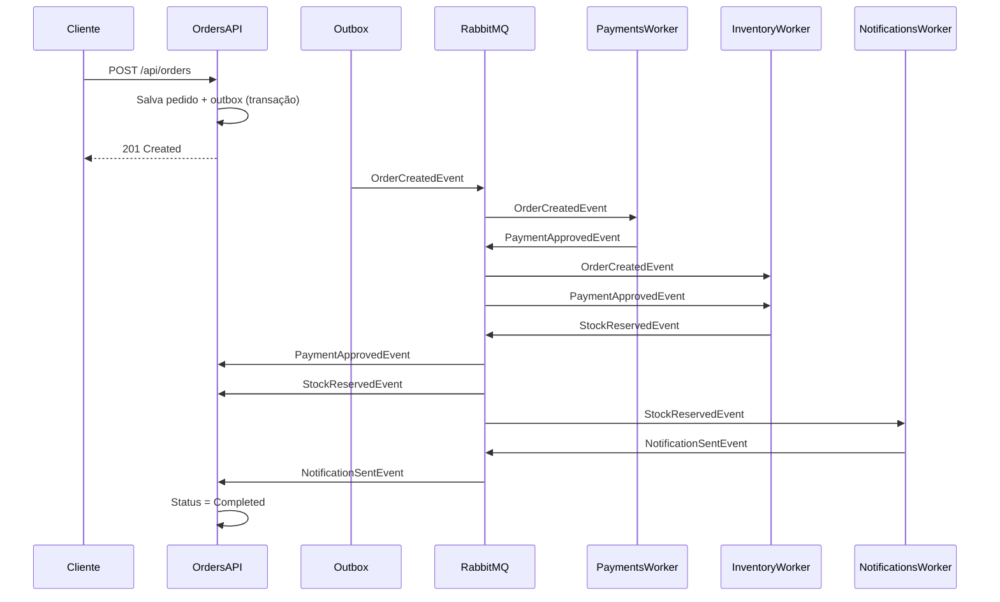

# EventDriven.OrderProcessing.RabbitMQ

Projeto de portfólio que demonstra **arquitetura orientada a eventos** com .NET 10, RabbitMQ, MassTransit, EF Core e PostgreSQL.

## Objetivo

Simular o fluxo assíncrono de processamento de pedidos com serviços desacoplados, Clean Architecture, testabilidade e práticas de produção adaptadas para demo local (migrations automáticas, health checks, observabilidade).

## Arquitetura

Cada etapa publica um **evento de integração** no RabbitMQ. Consumidores reagem apenas ao contrato do evento, sem acoplamento direto entre serviços.



Documentação adicional: [docs/architecture.md](docs/architecture.md), [docs/messaging-flow.md](docs/messaging-flow.md), [docs/demo.md](docs/demo.md).

## Stack

.NET 10 · ASP.NET Core · RabbitMQ · MassTransit 8.3.4 · EF Core 10 · PostgreSQL · MediatR · FluentValidation · Serilog · xUnit · Docker Compose

### Runtime (.NET 10 vs .NET 8 LTS)

O repositório usa **.NET 10** de forma intencional para portfólio (imagens Docker `sdk:10.0` / `aspnet:10.0`). O código **não depende** de APIs exclusivas do .NET 10.

Para forks com suporte LTS de longo prazo, recomenda-se migrar para **.NET 8** — ver [ADR 0005](docs/decisions/0005-target-framework-net10.md).

## Estrutura de pastas

```
src/
  BuildingBlocks/           # Contratos, mensageria, idempotência, outbox, observabilidade
  Services/
    Orders/                 # Api + Application + Domain + Infrastructure
    Payments/               # Worker + Application + Domain + Infrastructure
    Inventory/
    Notifications/          # Worker (persistência de idempotência)
tests/
docker/                     # Dockerfiles por serviço + init PostgreSQL
docs/
scripts/                    # Atalhos PowerShell para demo
docker-compose.yml
EventDriven.OrderProcessing.RabbitMQ.slnx
```

## Como executar (Docker Compose)

### Pré-requisitos

- Docker Desktop ou Docker Engine + Compose v2
- Portas: `8080`, `5432`, `5672`, `15672`
- .NET 10 SDK apenas se for rodar/testar fora do Docker (`dotnet test`, `dotnet run`)

### Comandos

```bash
docker compose down -v
docker compose up -d --build
docker compose ps
```

Atalho PowerShell (na raiz):

```powershell
.\scripts\docker-up.ps1 -Rebuild
.\scripts\demo-create-order.ps1
.\scripts\docker-down.ps1 -Volumes
```

### Serviços e portas

| Serviço | Descrição | URL / Porta |
|---------|-----------|-------------|
| orders-api | API HTTP | http://localhost:8080 |
| Swagger | UI da API (Development) | http://localhost:8080/swagger |
| Health | Health checks | http://localhost:8080/health |
| RabbitMQ Management | Console AMQP | http://localhost:15672 (`guest`/`guest`) |
| PostgreSQL | Bancos por serviço | `localhost:5432` (`postgres`/`postgres`) |

### Bancos criados no PostgreSQL

| Database | Serviço |
|----------|---------|
| `orders_db` | Orders API |
| `payments_db` | Payments Worker |
| `inventory_db` | Inventory Worker |
| `notifications_db` | Notifications Worker |

Script de init: `docker/postgres/init-databases.sql` (executado apenas com volume vazio).

### Migrations

Cada serviço aplica **EF Core migrations no startup** (adequado para demo local):

- Orders API → `MigrateOrdersDatabaseAsync`
- Payments Worker → `MigratePaymentsDatabaseAsync`
- Inventory Worker → `MigrateAndSeedInventoryAsync` (inclui produtos `PROD-001`…)
- Notifications Worker → `MigrateNotificationsDatabaseAsync`

## Testar o fluxo manualmente

1. Suba o ambiente (`docker compose up -d --build`).
2. Aguarde `orders-api` ficar **healthy** (`docker compose ps`).
3. Workers sobem em paralelo (dependem só de Postgres + RabbitMQ); mensagens aguardam na fila se necessário.
4. Crie um pedido (exemplo abaixo) e consulte até `status: Completed`.

Guia detalhado: **[docs/demo.md](docs/demo.md)**

### POST /api/orders

```bash
curl -s -X POST http://localhost:8080/api/orders \
  -H "Content-Type: application/json" \
  -d '{
    "customerId": "customer-1",
    "items": [
      { "productId": "PROD-001", "quantity": 1, "unitPrice": 99.90 }
    ]
  }'
```

### GET /api/orders/{id}

```bash
curl -s http://localhost:8080/api/orders/{ORDER_ID}
```

### GET /api/orders (paginado)

```bash
curl -s "http://localhost:8080/api/orders?page=1&pageSize=10"
```

## Status do pedido

| Status | Significado |
|--------|-------------|
| `Pending` | Pedido criado; aguardando processamento |
| `PaymentApproved` | Pagamento aprovado |
| `StockReserved` | Estoque reservado |
| `Completed` | Notificação enviada; fluxo concluído |
| `Failed` | Falha em pagamento, estoque ou regra de negócio |

## Garantias implementadas

| Recurso | Onde |
|---------|------|
| **Outbox** | Orders — grava evento na mesma transação do pedido; dispatcher publica no RabbitMQ |
| **Idempotência transacional** | Todos os consumers — `TryStartProcessingAsync` + mesma transação da regra de negócio |
| **CorrelationId** | Header `X-Correlation-Id` na API; propagado nos eventos e logs Serilog |
| **Retry MassTransit** | 3 tentativas com intervalo de 2s |
| **Logs estruturados** | Serilog com `Application` e `CorrelationId` |

## Desenvolvimento local (sem Docker)

```bash
# Infra
docker compose up -d postgres rabbitmq

# Migrations aplicam ao iniciar cada projeto
dotnet run --project src/Services/Orders/Orders.Api
dotnet run --project src/Services/Payments/Payments.Worker
dotnet run --project src/Services/Inventory/Inventory.Worker
dotnet run --project src/Services/Notifications/Notifications.Worker
```

Connection strings padrão em `appsettings.json` apontam para `localhost`.

## Testes

```bash
dotnet test
```

- Unitários: domínio, validações (Orders, Payments, Inventory)
- Integração: POST `/api/orders` com banco em memória
- **E2E (Testcontainers)**: fluxo completo até `Completed` — ver [docs/e2e-tests.md](docs/e2e-tests.md)

```bash
dotnet test tests/Orders.E2ETests/Orders.E2ETests.csproj
```

Requer Docker em execução (PostgreSQL + RabbitMQ via Testcontainers, sem mock).

## Logs e troubleshooting

```bash
docker compose logs -f orders-api
docker compose logs -f payments-worker
docker compose logs -f inventory-worker
docker compose logs -f notifications-worker
docker compose logs -f rabbitmq
```

Parar e remover volumes:

```bash
docker compose down -v
```

## Publicar no GitHub

Antes do primeiro push, evite versionar artefatos de build:

```bash
git init
git add .
# Se bin/obj já estiverem rastreados:
git rm -r --cached "**/bin" "**/obj" 2>/dev/null || true
git commit -m "Initial commit"
```

O `.gitignore` já cobre `bin/`, `obj/`, `.vs/`, `.vscode/` e logs.

## Decisões arquiteturais

- [ADR 0001 — Event-driven](docs/decisions/0001-use-event-driven-architecture.md)
- [ADR 0002 — RabbitMQ + MassTransit](docs/decisions/0002-use-rabbitmq-with-masstransit.md)
- [ADR 0003 — Workers](docs/decisions/0003-use-workers-for-async-processing.md)
- [ADR 0004 — MassTransit 8 (não v9)](docs/decisions/0004-use-masstransit-8-not-version-9.md)
- [ADR 0005 — Target .NET 10](docs/decisions/0005-target-framework-net10.md)

## Limitações conhecidas

- MassTransit **8.3.4** — v9 exige licença; ver [ADR 0004](docs/decisions/0004-use-masstransit-8-not-version-9.md)
- Outbox apenas no serviço **Orders**; Payments/Inventory publicam direto no broker
- Publicação em workers não é transacional com o banco (exceto marcação idempotente)
- Sem DLQ explícita / saga / OpenTelemetry
- Ambiente Docker é para **demo**; não representa hardening de produção

## Melhorias futuras

- Outbox nos demais serviços
- Migração opcional para .NET 8 LTS (forks de produção)
- Testes E2E com Testcontainers
- DLQ e observabilidade avançada
