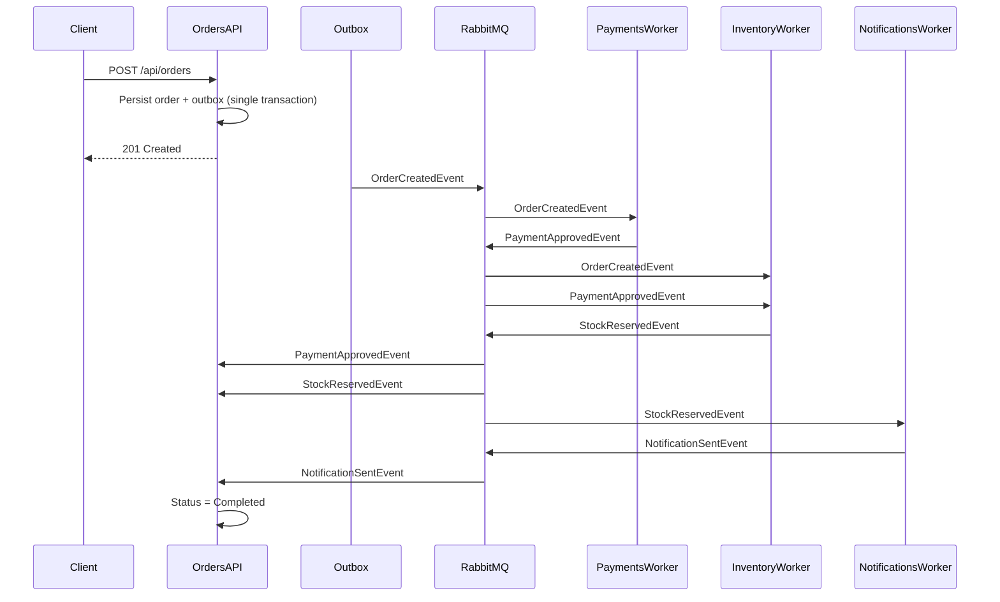

# EventDriven.OrderProcessing.RabbitMQ

Production-like event-driven order processing system built with .NET 10, RabbitMQ, MassTransit, PostgreSQL, EF Core, Clean Architecture, Outbox Pattern, transactional idempotency, workers, Docker Compose, and structured observability.

## Purpose

This repository is a **portfolio and demonstration project** that simulates asynchronous order processing with decoupled services. It showcases event-driven architecture, Clean Architecture boundaries, testability, and production-oriented practices adapted for local demo (automatic migrations, health checks, structured logging, and correlation IDs).

It is not a production-hardened deployment. Treat it as a reference implementation you can run locally with Docker Compose.

## Architecture overview

Each step in the order flow publishes an **integration event** to RabbitMQ. Consumers react only to event contracts — there is no direct service-to-service HTTP coupling.



See also: [docs/architecture.md](docs/architecture.md), [docs/messaging-flow.md](docs/messaging-flow.md), [docs/demo.md](docs/demo.md).

## Runtime services

| Service | Role |
|---------|------|
| **Orders API** | HTTP entry point; owns order state; persists orders and outbox messages in one transaction; consumes downstream events to update status |
| **Outbox dispatcher** | Background worker inside Orders API; publishes pending outbox messages to RabbitMQ |
| **Payments Worker** | Simulates payment processing; consumes `OrderCreatedEvent`; publishes `PaymentApprovedEvent` or `PaymentRejectedEvent` |
| **Inventory Worker** | Simulates stock reservation; consumes `OrderCreatedEvent` and `PaymentApprovedEvent`; publishes `StockReservedEvent` or `StockReservationFailedEvent` |
| **Notifications Worker** | Simulates customer notification; consumes `StockReservedEvent`; publishes `NotificationSentEvent` |
| **PostgreSQL** | Per-service persistence (orders, payments, inventory, notifications, idempotency records) |
| **RabbitMQ** | Async message broker for integration events |

## Messaging flow

1. Client sends `POST /api/orders` to the Orders API.
2. Orders API saves the order and an outbox message in a **single database transaction**.
3. `201 Created` means the order exists and the integration event is durably stored in the outbox.
4. The outbox dispatcher publishes `OrderCreatedEvent` to RabbitMQ.
5. Payments Worker consumes `OrderCreatedEvent` and publishes `PaymentApprovedEvent`.
6. Inventory Worker reacts to order/payment events and publishes `StockReservedEvent`.
7. Notifications Worker consumes `StockReservedEvent` and publishes `NotificationSentEvent`.
8. Orders API consumes subsequent events and updates order status until `Completed` (or `Failed` on error paths).

Full event sequence: [docs/messaging-flow.md](docs/messaging-flow.md).

## Order lifecycle

| Status | Meaning |
|--------|---------|
| `Pending` | Order was created and is waiting for asynchronous processing |
| `PaymentApproved` | Payment was approved by the Payments Worker |
| `StockReserved` | Stock was successfully reserved by the Inventory Worker |
| `Completed` | Notification was sent; the order flow finished successfully |
| `Failed` | Payment, stock, or business rule failure |

Happy path: `Pending` → `PaymentApproved` → `StockReserved` → `Completed`.

## Outbox Pattern

Implemented in the **Orders** service only:

- When an order is created, `OrderCreatedEvent` is written to the `outbox_messages` table in the **same transaction** as the order.
- `OutboxDispatcherBackgroundService` polls pending messages and publishes them to RabbitMQ via MassTransit.
- This guarantees the integration event is never lost if the API transaction commits.

Configuration (Orders API): `Outbox__BatchSize`, `Outbox__PollIntervalSeconds`, `Outbox__MaxRetryCount`.

## Consumer idempotency

All MassTransit consumers use **transactional idempotency** via `IdempotentConsumerExecutor`:

- Before processing, the consumer checks `(EventId, ConsumerName)` in `processed_messages`.
- The idempotency record and business side effects run in the **same database transaction**.
- Duplicate deliveries are skipped with an informational log.

## Production-like decisions

| Decision | Implementation |
|----------|----------------|
| Service decoupling | Integration events over RabbitMQ |
| Message handling | MassTransit consumers |
| Durable order creation | Order and outbox message persisted in a single transaction |
| Async publication | Outbox dispatcher publishes pending messages |
| Idempotent consumers | Transactional idempotency records |
| Retry policy | MassTransit message retry (5 attempts, 2-second intervals) |
| Local persistence | PostgreSQL database per service |
| Observability | Serilog structured logging + `X-Correlation-Id` propagation |
| Health checks | API and infrastructure readiness endpoints |
| Local environment | Docker Compose |

## Why RabbitMQ and MassTransit?

- **RabbitMQ** provides reliable async messaging between independently deployable services.
- **MassTransit 8.3.4** simplifies consumer wiring, message contracts, retry policies, endpoint conventions, and RabbitMQ integration.
- MassTransit **8.x** is used intentionally so the repository remains open and runnable without commercial licensing. MassTransit 9 requires a license for production use — see [ADR 0004](docs/decisions/0004-use-masstransit-8-not-version-9.md).

## Repository structure

```
src/
  BuildingBlocks/           # Contracts, messaging, idempotency, outbox, observability
  Services/
    Orders/                 # Api + Application + Domain + Infrastructure
    Payments/               # Worker + Application + Domain + Infrastructure
    Inventory/
    Notifications/          # Worker (idempotency persistence)
tests/
docker/                     # Dockerfiles per service + PostgreSQL init script
docs/
docker-compose.yml
EventDriven.OrderProcessing.RabbitMQ.slnx
```

**Stack:** .NET 10 · ASP.NET Core · RabbitMQ · MassTransit 8.3.4 · EF Core 10 · PostgreSQL · MediatR · FluentValidation · Serilog · xUnit · Docker Compose · Testcontainers

### Runtime (.NET 10)

This project intentionally targets **.NET 10** (`net10.0` in `Directory.Build.props`; Docker images use `sdk:10.0` / `aspnet:10.0`). The application code does **not** depend on .NET 10–exclusive APIs.

For long-term production forks, you may choose an LTS version (for example .NET 8) according to your support policy — see [ADR 0005](docs/decisions/0005-target-framework-net10.md).

## Running with Docker Compose

### Prerequisites

- Docker Desktop or Docker Engine + Compose v2
- Free ports: `8080`, `5432`, `5672`, `15672`
- .NET 10 SDK only if running or testing outside Docker (`dotnet test`, `dotnet run`)

### Commands

```bash
docker compose down -v
docker compose up -d --build
docker compose ps
```

## Services and ports

| Service | Description | URL / Port |
|---------|-------------|------------|
| orders-api | HTTP API | http://localhost:8080 |
| Swagger | API UI (Development) | http://localhost:8080/swagger |
| Health | Health checks | http://localhost:8080/health |
| RabbitMQ Management | AMQP management UI | http://localhost:15672 (`guest` / `guest`) |
| PostgreSQL | Per-service databases | `localhost:5432` (`postgres` / `postgres`) |

Workers (`payments-worker`, `inventory-worker`, `notifications-worker`) have no exposed HTTP ports. They depend on PostgreSQL and RabbitMQ health checks only.

> **Demo credentials only.** `guest`/`guest` and `postgres`/`postgres` are for local development. Do not use them in production.

## Databases

| Database | Service |
|----------|---------|
| `orders_db` | Orders API |
| `payments_db` | Payments Worker |
| `inventory_db` | Inventory Worker |
| `notifications_db` | Notifications Worker |

Init script: `docker/postgres/init-databases.sql` (runs only on first startup with an empty volume).

## Migrations

Each service applies **EF Core migrations on startup** (appropriate for local demo):

- Orders API → `MigrateOrdersDatabaseAsync`
- Payments Worker → `MigratePaymentsDatabaseAsync`
- Inventory Worker → `MigrateAndSeedInventoryAsync` (seeds `PROD-001`, `PROD-002`, `PROD-003`)
- Notifications Worker → `MigrateNotificationsDatabaseAsync`

## Manual flow validation

1. Start the environment: `docker compose up -d --build`.
2. Wait until `orders-api` is **healthy** (`docker compose ps`).
3. Workers start in parallel (they depend only on Postgres + RabbitMQ); messages queue until consumers connect.
4. Create an order (example below) and poll until `status: Completed`.

Detailed walkthrough: **[docs/demo.md](docs/demo.md)**

### POST /api/orders

```bash
curl -s -X POST http://localhost:8080/api/orders \
  -H "Content-Type: application/json" \
  -d '{
    "customerId": "customer-1",
    "items": [
      { "productId": "PROD-001", "quantity": 1, "unitPrice": 99.90 }
    ]
  }'
```

### GET /api/orders/{id}

```bash
curl -s http://localhost:8080/api/orders/{ORDER_ID}
```

### GET /api/orders (paginated)

```bash
curl -s "http://localhost:8080/api/orders?page=1&pageSize=10"
```

Optional correlation ID:

```bash
curl -s -X POST http://localhost:8080/api/orders \
  -H "Content-Type: application/json" \
  -H "X-Correlation-Id: demo-123" \
  -d '{ "customerId": "customer-1", "items": [{ "productId": "PROD-001", "quantity": 1, "unitPrice": 99.90 }] }'
```

## Local development without Docker

```bash
# Infrastructure only
docker compose up -d postgres rabbitmq

# Migrations apply on startup for each project
dotnet run --project src/Services/Orders/Orders.Api
dotnet run --project src/Services/Payments/Payments.Worker
dotnet run --project src/Services/Inventory/Inventory.Worker
dotnet run --project src/Services/Notifications/Notifications.Worker
```

Default connection strings in `appsettings.json` point to `localhost`.

## Build and tests

```bash
dotnet restore
dotnet build
dotnet test
```

| Layer | Coverage |
|-------|----------|
| Unit tests | Domain rules and validations (Orders, Payments, Inventory) |
| Integration tests | `POST /api/orders` with in-memory database |
| E2E tests (Testcontainers) | Full flow until `Completed` — see [docs/e2e-tests.md](docs/e2e-tests.md) |

```bash
dotnet test tests/Orders.E2ETests/Orders.E2ETests.csproj
```

**E2E tests require Docker to be running** (PostgreSQL + RabbitMQ via Testcontainers; no broker or database mocks).

## Logs and troubleshooting

```bash
docker compose logs -f orders-api
docker compose logs -f payments-worker
docker compose logs -f inventory-worker
docker compose logs -f notifications-worker
docker compose logs -f rabbitmq
```

Stop and remove volumes:

```bash
docker compose down -v
```

| Symptom | Likely cause | Action |
|---------|--------------|--------|
| `orders-api` unhealthy | RabbitMQ still starting, migration failure | `docker compose logs orders-api` |
| Order stuck in `Pending` | Outbox not dispatched or workers stopped | Check outbox logs in `orders-api` and `payments-worker` logs |
| Order `Failed` | Payment rejected or insufficient stock | `GET /api/orders/{id}` → `failureReason`; use seeded SKUs |
| Missing database | Old Postgres volume without all DBs | `docker compose down -v` and restart |
| Port conflict | Another Postgres/RabbitMQ on host | Stop conflicting service or change Compose ports |

## Conscious trade-offs

### Known limitations

| Limitation | Reason |
|------------|--------|
| Outbox only in Orders service | Keeps the demo focused while demonstrating the pattern clearly |
| Payments and Inventory publish directly to RabbitMQ | Simpler implementation for portfolio scope |
| No explicit DLQ yet | Can be added as a future production-hardening improvement |
| No saga / state machine | The goal is to showcase event-driven choreography first |
| No OpenTelemetry yet | Serilog + CorrelationId are sufficient for current scope |
| Docker Compose only | Simplifies and makes local execution accessible |

### Decision costs and benefits

| Decision | Benefit | Cost |
|----------|---------|------|
| Event-driven choreography | Flexible decoupling between services | Harder end-to-end tracing |
| Outbox Pattern | Durable event per order creation | Eventual consistency between DB and broker |
| MassTransit | Simplified RabbitMQ integration | Framework-specific conventions |
| Database per service | Better service ownership | More local infrastructure |
| Automatic migrations on startup | Easy demo bootstrap | Not suitable for all production deployment models |

## Future improvements

- Outbox Pattern in Payments and Inventory services
- Explicit dead-letter queue (DLQ) and poison-message handling
- OpenTelemetry traces and metrics
- Kubernetes manifests or cloud deployment examples
- Optional migration to an LTS .NET version for long-term production forks

## Documentation

- [Architecture](docs/architecture.md)
- [Messaging flow](docs/messaging-flow.md)
- [Demo walkthrough](docs/demo.md)
- [E2E tests](docs/e2e-tests.md)
- [Contributing](CONTRIBUTING.md)
- [Security policy](SECURITY.md)
- Architecture Decision Records:
  - [ADR 0001 — Event-driven architecture](docs/decisions/0001-use-event-driven-architecture.md)
  - [ADR 0002 — RabbitMQ + MassTransit](docs/decisions/0002-use-rabbitmq-with-masstransit.md)
  - [ADR 0003 — Workers for async processing](docs/decisions/0003-use-workers-for-async-processing.md)
  - [ADR 0004 — MassTransit 8 (not v9)](docs/decisions/0004-use-masstransit-8-not-version-9.md)
  - [ADR 0005 — Target .NET 10](docs/decisions/0005-target-framework-net10.md)

## License

This project is licensed under the [MIT License](LICENSE).
